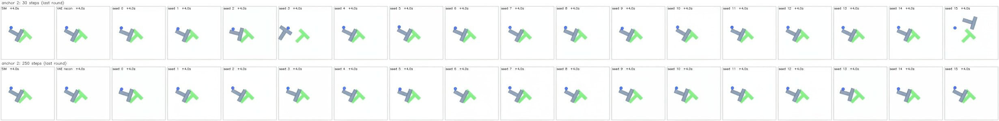
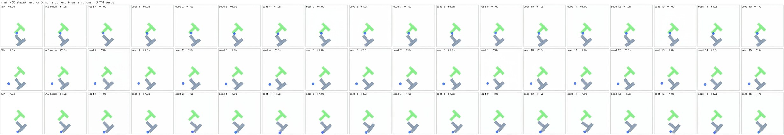
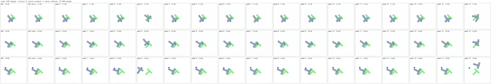
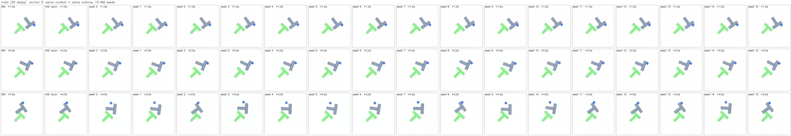
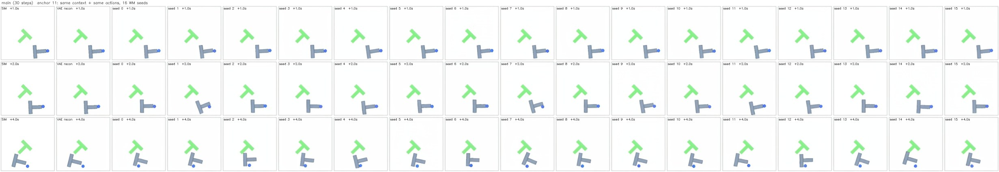

# NanoWM 的 seed 多樣性：同 context、同動作，只換 WM seed

狀態：**已完成**（2026-10-08）。腳本 `eval/wm_seed_diversity.py`，原始輸出在 `~/datastorage/nanowm_pusht_aug/wm_seed_diversity/`（`summary.md` / `summary.json` / `grids/`）。

## 結論

1. **多樣性小，而且集中在接觸段。** 第 8 round（+4.0 s）block CoG 在 16 個 seed 間的標準差，平均 8.3 px [4.2, 13.4]，但中位數 anchor 只有 3.7 px（工作區 512 px，T 寬 120 px）。block 沒被推到的 anchor 只有 2.2 px，比同一批 seed 間 **agent** 位置的抖動（4.3 px，agent 由動作完全決定）還小；block 被推動的 anchor 是 10.3 px [5.1, 16.4]。20 個 anchor 裡只有 5 個的 block 離散度超過 agent 抖動的 2 倍。
2. **不模糊：生成幀和「完美世界模型 + VAE decode」一樣清楚。** block 邊緣寬度：生成 2.12 px、真實幀經 VAE encode→decode 2.07 px、sim 渲染 1.71 px。生成 / recon 比值 1.025–1.034（CI 不含 1，可量到但很小），8 個 round 內沒有變大；2560 個樣本裡最糊的一張也只有 recon 的 1.27 倍。相對 sim 多出來的邊緣寬度，84–88% 來自 SD-VAE，生成本身只佔 12–16%。
3. **錯誤型態是「清楚但錯」，不是糊掉。** 沒有任何樣本被判為模糊或 block 消失；錯的樣本（block 偏 > 20 px 或 > 15°）在 +4.0 s 佔 9% [1%, 21%]（29 / 320），分佈在 5 個 anchor，其中 27 個來自下面 3 個 anchor，型態各不相同：
   - **系統性低估**（anchor 11）：16 個 seed 彼此一致，但都把 block 留在原地附近，sim 裡 block 被推走 194 px；seed 平均的誤差 84 px，離散度只有 28 px。
   - **多峰、真值在少數峰**（anchor 5）：sim 中 block 轉了約 40°，16 個 seed 分成「有轉」和「沒轉」兩群，沒轉的佔多數（62% 的 seed 錯）。
   - **偶發姿態跳變**（anchor 2）：多數 seed 貼近真值，少數 seed（3、15）的 block 一開始就跳到另一個姿態，最大誤差 151 px。
4. **離散度大致反映了誤差。** 每 anchor 的 seed 離散度和單樣本誤差的 Spearman ρ = 0.79（p < 1e-4，n = 20）。真值落在 16 個樣本範圍內的比例，逐維平均 0.8–0.95，接近校準值 15/17 = 0.88；只在系統性低估（anchor 11）時明顯失準。
5. **30 步沒有比 250 步糊。** 在同 8 個 anchor 上配對比較，250 步的 生成 / recon 邊緣寬度比只低 0.008 [0.007, 0.009]（< 1%）。250 步下 anchor 5 的兩峰依舊；anchor 2 的姿態跳變則沒出現（16 個 seed 全對），但只有一個 anchor，無法判斷是步數的效果還是雜訊不同。

對 DiWA 式 PPO 的意義：NanoWM 給的隨機性是「接觸處不同結果的清楚樣本」，這是 MSE 模型做不到的；但它的量級小（多數 anchor 只有數 px），而且最大的失敗模式（anchor 11 這種一致地低估推動）無法靠多抽 seed 發現。把 WM seed 當作環境隨機性來源是可行的，但不能預期它大幅擴展探索範圍。

## 1. 問題

NanoWM（SD-VAE latent DiT + diffusion forcing，DFoT sequential、DDIM eta = 0、history_stabilization_level = 0.02）相對 DINO-WM / LeWM 的賣點，是測試時同樣輸入能抽出不同而清晰的未來。SAILOR 的候選都帶不同動作，所以這個性質從沒單獨量過。已知 VAE 解碼比 gym 渲染模糊（`datagen/coverage_from_frame.py` 註解），也看過 block 姿態幻覺。要回答：只換 WM seed 時，(a) 樣本差多少，(b) 糊不糊、糊從哪來，(c) 錯的時候長什麼樣。

## 2. 設計

| 項目 | 設定 |
| --- | --- |
| anchor | `sailor_v1/seeds_test.npz` 前 20 個（base policy reset rollout 中段的狀態，body-origin） |
| 真實 rollout | `closed_loop_rollout.run_lead_in`（與 closed loop 相同的 lead-in），base policy（`ckpt.base`，torch seed 0）在 gym_pusht 從 anchor 連續跑 55 步；前 10 步產生 3 幀真實 context，其餘動作 **replay** 給 NanoWM，sim 每 5 步的 224px 幀當真值 |
| 動作 window | closed_loop_rollout 的 alignment contract：round r = stream[5r : 5r+20]，生成 stream 第 5(3+r) 步的幀；相對動作用 sim 的真實 agent 位置（同 `wm_fidelity_ood`），不用 pd_step 估計 |
| WM 取樣 | 每個 anchor 在同一個 worker batch 內複製 16 份（`imagined_rollout.py closed-loop --seed 0`），每份拿到同一個 seeded RNG 的不同雜訊列，等同 16 個 WM seed；8 round、num_sampling_steps 30（`configs/nanowm_pusht_common.yaml`） |
| 對照 | `steps250`：前 8 個 anchor、250 步，其餘相同 |
| VAE recon | 每張 sim 幀經 worker 自己的 encode / decode 路徑（新增的 `imagined_rollout.py recon`）：完美世界模型會給的畫面 |
| 位姿 / coverage 估計 | `wm_fidelity_ood.measure`（`coverage_from_frame` 的 mask + moments），sim 幀、recon、生成幀都用同一個估計器 |
| 清晰度 | block 邊緣寬度 = block 內外灰階對比 / 邊緣帶 p90 梯度（px，越小越銳利），以及 Laplacian 變異數；「模糊」= 邊緣寬度 > 1.3 × 同一 sim 幀 recon 的寬度 |
| 「正確」 | block CoG 距 sim < 20 px 且角度差 < 15° 且 block 沒消失 |
| 統計 | 每 round 先在 anchor 內對 seed 平均，再對 20 個 anchor 平均；95% CI 為對 anchor 的 percentile bootstrap（4000 次） |

距離單位皆為 sim px（512 px 工作區；224px 影像上 1 px ≈ 2.3 sim px）。

可重跑：

```bash
CUDA_VISIBLE_DEVICES=7 uv run --extra training python examples/nanowm_pusht_aug/eval/wm_seed_diversity.py all --n-anchors-250 8
```

### 驗證

- worker 加了 `--seed`（預設 `None` = 原本不設 seed 的行為）：context encode 前 `torch.manual_seed(seed)`，每個 round 取樣前 `seed + 1 + r`。`detcheck`：同 seed 兩次逐位元相同（max |diff| = 0）；換 seed 或同 batch 內不同副本，幀都不同（灰階平均絕對差 1.06 / 1.02，兩者同量級，支持「batch 內副本 ≈ 不同 seed」）。
- SD-VAE posterior 雜訊可忽略（`base_v2_latent.md`：scaled std 1.8e-5），所以樣本間的差異幾乎全部來自 diffusion 的初始雜訊和 history stabilization 雜訊。
- 估計器底噪：同一幀 sim vs recon 的 block 位置差 0.7 px [0.5, 0.9]、角度 0.9°，遠小於下面的效應。
- 動作確實推到 block：20 個 anchor 中 15 個在 4 s 內 block 移動 > 20 px；block 平均位移從 +0.5 s 的 12 px 到 +4.0 s 的 60 px。

## 3. 結果

### 3.1 多樣性（seed 間標準差）

| round (+s) | block 位置 sd | 有推動 / 未推動 | 中位 anchor | 角度 sd (°) | coverage sd | agent 位置 sd |
| --- | --- | --- | --- | --- | --- | --- |
| 0 (+0.5) | 1.3 [0.9, 1.7] | 1.5 / 0.6 | 1.0 | 1.4 [1.0, 1.9] | 0.007 [0.004, 0.011] | 1.4 [1.2, 1.5] |
| 1 (+1.0) | 2.4 [1.3, 4.0] | 2.8 / 1.1 | 1.5 | 2.0 [1.3, 3.1] | 0.011 [0.006, 0.017] | 2.0 [1.8, 2.2] |
| 3 (+2.0) | 3.7 [2.1, 6.0] | 4.4 / 1.5 | 2.0 | 2.4 [1.6, 3.5] | 0.019 [0.011, 0.028] | 3.1 [2.8, 3.4] |
| 5 (+3.0) | 6.3 [3.1, 10.7] | 7.8 / 1.9 | 2.8 | 3.4 [2.4, 4.6] | 0.023 [0.015, 0.031] | 3.9 [3.6, 4.2] |
| 7 (+4.0) | 8.3 [4.2, 13.4] | 10.3 / 2.2 | 3.7 | 5.4 [3.2, 7.8] | 0.036 [0.025, 0.050] | 4.6 [4.2, 5.0] |

- 離散度隨時間單調增加，但平均值被少數 anchor 拉高（平均 8.3 vs 中位 3.7）。
- agent 位置由動作決定，它的 seed 間 sd（+4.0 s 時 4.6 px）可以當作 NanoWM 的「位置抖動」底線。未推動 anchor 的 block sd（2.2 px）在這條底線之下 —— 沒有接觸時 block 幾乎不動，模型也知道。
- 有推動的 anchor：block sd 10.3 px [5.1, 16.4]、角度 sd 6.6° [3.9, 9.5]（未推動 1.8°）。

### 3.2 準確度與覆蓋

| round (+s) | 單樣本誤差 | seed 平均的誤差 | 真值在範圍內 x / y / 角度 | 系統性失準 anchor 比例 |
| --- | --- | --- | --- | --- |
| 0 (+0.5) | 1.8 [1.4, 2.3] | 1.5 [1.2, 1.8] | 0.75 / 0.80 / 0.70 | 0 |
| 3 (+2.0) | 3.7 [2.5, 5.2] | 2.7 [1.6, 4.1] | 0.95 / 0.90 / 0.80 | 0 |
| 5 (+3.0) | 7.3 [3.8, 12.8] | 6.0 [2.7, 11.4] | 0.90 / 0.80 / 0.90 | 0.05 [0, 0.15] |
| 7 (+4.0) | 10.6 [4.8, 19.7] | 8.6 [3.1, 17.5] | 0.80 / 0.80 / 0.85 | 0.05 [0, 0.15] |

- 「真值在範圍內」= sim 的值落在 16 個樣本的 [min, max] 內；樣本可交換時的期望值是 15/17 = 0.88。round 0 偏低，是因為那時離散度（~1 px）跟 VAE / 估計器底噪同量級；用 recon 當真值時 round 0 是 0.90 / 0.95 / 0.80。之後大致在 0.8–0.95。
- 系統性失準 = seed 平均離真值 > 20 px 且 > 2 倍離散度。只有 anchor 11。
- seed 平均比單樣本準（+4.0 s：8.6 vs 10.6 px），但差距不大，因為多數 anchor 的樣本本來就集中。

### 3.3 清晰度

| round | 邊緣寬度：生成 | VAE recon | sim | 生成 / recon | Laplacian 變異數 生成 / recon / sim |
| --- | --- | --- | --- | --- | --- |
| 0 | 2.12 [2.04, 2.21] | 2.07 [2.00, 2.15] | 1.72 [1.65, 1.79] | 1.025 [1.016, 1.034] | 1119 / 1229 / 3855 |
| 3 | 2.12 [2.05, 2.21] | 2.06 [1.99, 2.15] | 1.70 [1.64, 1.78] | 1.030 [1.022, 1.039] | 1099 / 1221 / 3839 |
| 7 | 2.14 [2.06, 2.21] | 2.07 [1.99, 2.16] | 1.71 [1.64, 1.79] | 1.034 [1.012, 1.056] | 1108 / 1204 / 3782 |

- 全部 2560 個樣本的 生成 / recon 邊緣寬度比：p50 1.025、p90 1.072、p99 1.168、最大 1.266。
- 用 Laplacian 看是同樣的結論：VAE 拿掉約 2/3 的高頻能量（3800 → 1200），生成再少約 9%。
- 自回歸 8 round 後沒有累積模糊（邊緣寬度 2.12 → 2.14，CI 重疊）。

### 3.4 錯誤型態（每個 seed 樣本）

| round | 清楚且正確 | 清楚但錯 | 模糊 | block 消失 |
| --- | --- | --- | --- | --- |
| 0 | 1.00 | 0.00 | 0 | 0 |
| 3 | 0.99 [0.97, 1.00] | 0.01 [0.00, 0.03] | 0 | 0 |
| 5 | 0.94 [0.85, 1.00] | 0.06 [0.00, 0.15] | 0 | 0 |
| 7 | 0.91 [0.79, 0.99] | 0.09 [0.01, 0.21] | 0 | 0 |

+4.0 s 時每個 anchor 的情況（只列有錯的）：

| anchor | block 位置 sd | 角度 sd | 單樣本誤差 平均 / 最大 | seed 平均誤差 | 錯的比例 | 型態 |
| --- | --- | --- | --- | --- | --- | --- |
| 11 | 27.8 | 9.6 | 85.1 / 106.1 | 84.4 | 0.94 | 一致地低估推動距離（sim 位移 194 px） |
| 5 | 21.7 | 18.8 | 27.3 / 49.0 | 23.0 | 0.62 | 旋轉與否兩峰，真值在少數峰 |
| 2 | 43.9 | 17.5 | 19.5 / 150.7 | 10.2 | 0.12 | 少數 seed 姿態跳變 |
| 9 | 9.2 | 13.0 | 4.8 / 37.2 | 3.5 | 0.06 | 單一 seed 偏離 |
| 12 | 12.0 | 9.4 | 9.3 / 34.5 | 3.0 | 0.06 | 單一 seed 偏離 |

其餘 15 個 anchor 全部 16 個 seed 都正確，block sd 1.7–6.4 px。

### 3.5 30 步 vs 250 步

前 8 個 anchor（6 個有推動），250 步，其餘相同。配對差（250 − 30，對 anchor bootstrap）：

| 指標 | 250 − 30 |
| --- | --- |
| 邊緣寬度（px） | −0.017 [−0.020, −0.014] |
| 邊緣寬度 生成 / recon | −0.008 [−0.009, −0.007] |
| 單樣本 block 誤差（px，8 round 平均） | −0.9 [−3.0, +0.3] |
| block 位置 sd（px，8 round 平均） | −2.7 [−8.0, +0.1] |
| block 消失率 | 0 |

- 250 步略銳利，但差距不到 1%，遠小於 VAE 造成的差距（recon 比 sim 寬 21%）。30 步不是模糊的來源。
- 250 步的 +4.0 s：block sd 6.1 px [3.4, 10.0]、清楚但錯 9% [0, 26%]（全部來自 anchor 5，69% 的 seed 錯，兩峰仍在），模糊 0。
- 離散度與誤差的下降幾乎都來自 anchor 2：30 步有 2 個 seed 跳變（block sd 43.9 px），250 步沒有（5.7 px）。只有這一個例子，且兩個 arm 的雜訊不同，無法歸因到步數。



## 4. 圖

每張 grid：列 = +1.0 / +2.0 / +4.0 s，欄 = sim、VAE recon、seed 0–15。

- 典型 anchor（全部正確，樣本幾乎相同）：
- 姿態跳變（anchor 2，seed 3、15）：
- 兩峰（anchor 5）：
- 系統性低估（anchor 11）：
- +4.0 s block 放大 3 倍（sim | recon | seed 0–5）。anchor 0 看邊緣：生成幀和 recon 一樣；anchor 5 看兩峰，每張都清楚：
  
  

## 5. 限制

- 16 個「seed」是同一個 seeded RNG 在同一 batch 內的不同雜訊列，不是 16 次獨立的 `--seed`。兩者在統計上等價（每列雜訊獨立同分佈），但單一 branch 的結果會隨它在 batch 中的位置改變。
- 20 個 anchor 只覆蓋 base policy 在 reset 分佈中段的狀態；top-wall 這類 OOD 區域（`wm_fidelity_ood`）沒有測。錯誤集中在 3 個 anchor，所以「清楚但錯」比例的 CI 很寬。
- 位姿來自影像估計器；對生成幀、recon、sim 用同一個估計器，sim vs recon 的底噪 < 1 px。
- 清晰度門檻（1.3 倍 recon）是依分佈挑的；資料中沒有任何樣本接近它，所以「沒有模糊樣本」對門檻選擇不敏感。另外試過以 block 邊緣帶 Laplacian 比值 < 0.7 當門檻：會標出 85 個樣本，但人工檢查這些樣本並不糊（受 block 與 goal 重疊、輪廓顏色影響），所以沒有採用。
