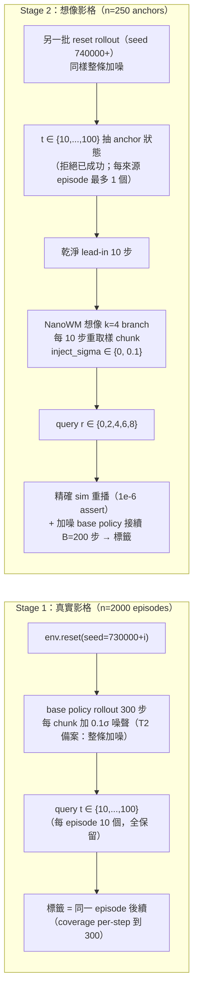

# SAILOR v1 計畫簡介

> 完整預先註冊文件：[`docs/decisions/sailor_v1.md`](./decisions/sailor_v1.md)；config：[`configs/sailor_v1_reset.yaml`](../../../configs/sailor_v1_reset.yaml)

## 1. 目的與方法

**目的**：在 PushT 上驗證 SAILOR（arXiv 2506.05294）的做法——用 Reward Model（RM）+ Value Model（V）在 world model（NanoWM）的**想像 rollout** 中替 base policy 的候選 action chunk 打分排序，並回答：

> 以 NanoWM latent 訓練的 ValueNet（V + RM 雙 head）能否在想像 rollout 上對候選 chunk 排序，且離線 Best-of-N 的成功率提升顯著大於 0？

並以 OracleNet（真實 8 維狀態）為對照，把差距拆解為「編碼器損失」與「WM 幻覺」。線上 Best-of-N 不在本計畫範圍。

### RM 與 V model 設計

- **ValueNet**：輸入 3 幀 SD-VAE latent（H=3, fi=5）+ agent state；三個 head：
  - **V head**：BCE 對 soft label `v_target = γ^T · 1[T ≤ B]`（γ=0.995，B=200 步窗口，T = query 到首次 coverage > 0.95 的步數；訓練時 β=0）。
  - **RM head**：sigmoid 後 MSE 對**真實 sim coverage**（stage 1 = `coverage(t)`；stage 2 = 重播後 `sim_cov`）。
  - **pose aux**：輔助回歸。
- **OracleNet**：8 維真實狀態（agent xy/vel、CoG xy/512、sinθ、cosθ），同一訓練程序，作為上限對照。
- **搜尋分數**：`score = V(z_end) + β · RM(z_end)`，β ∈ {0, 0.1, 0.3}（預先固定；β 只在 val 上選，定性為 greedy coverage bonus）。
- **訓練設定**：ensemble 5 + bootstrap；grouped 三切分（val / es / fit，以 episode / anchor 為 group）；Normalizer 只在 fit split 擬合；shuffled-label 對照必跑。

## 2. Stage 1 / Stage 2 資料搜集流程

- **Stage 1（真實影格）**
  - 隨機 `env.reset(seed=730000+i)`，n=2000，base policy 跑滿 300 步。
  - 依 T2(a) 結果（Δ=+1.30 pp ≤ 2 pp）採備案：**每個 chunk 都加 0.1σ 噪聲**、不丟 query。
  - query 時刻 t ∈ {10,…,100}；標籤直接取自同一條 episode 的後續真實軌跡。
- **Stage 2（想像影格）**
  - anchor 來自另一批加噪 reset rollout（seed 740000+），t ∈ {10,…,100} 抽 250 個決策點。
  - 乾淨 lead-in 10 步後，NanoWM 想像 k=4 個 branch，每 10 步（2 round）重取樣 chunk，候選 chunk 加 `inject_sigma ∈ {0, 0.1}`。
  - query 在 r ∈ {0,2,4,6,8}（= 想像 0/10/20/30/40 步）。
  - 標籤：精確 sim 重播想像段（1e-6 assert）後，由加噪 base policy 接續 200 步，記錄成功時刻與 coverage。
  - σ=0 與 σ=0.1 共用同一 anchor / lead-in / torch seed → 8 個候選（k=4 × 2σ）證明性地成對。

## 3. 實驗結果（預期比較表）

> Gate 門檻由 Opus 在 T5、看到任何 val 之前填入；目前 `gate: {}`，report fail closed。

### 表 A：2×2 診斷表（AUROC / ECE / within-anchor AUROC / RM MAE，bootstrap 95% CI）

|  | stage-1 val（真實影格） | stage-2 r=0（真實影格、stage-2 分佈） | stage-2 val r≥2（想像影格） |
| --- | --- | --- | --- |
| **ValueNet（latent）** | a | — | b |
| **OracleNet（state）** | c | — | d |

- `c − a` = 編碼器損失；`d − b` = 編碼器 + WM 幻覺（限 block pose；agent state 兩邊皆為真值）
- `(d−b) − (c−a)` ≈ WM 幻覺；`c − d` = 想像分佈本身較難
- 第三欄（r=0）：`(r=0) − (stage-1)` 隔離狀態分佈位移；`(r≥2) − (r=0)` 隔離想像本身

### 表 B：Gate

| gate | 指標 | 門檻 | 資料 |
| --- | --- | --- | --- |
| G1 | stage-1 reset AUROC ≥ T1，`ECE_soft` ≤ E1 | TBD（Opus） | val |
| G2 | stage-2 r≥2 AUROC ≥ T2 | TBD | val |
| G3 | within-anchor AUROC ≥ T3（須低於表 D 雜訊天花板） | TBD | val |
| G4 | ensemble std 有資訊量（\|V − v_target\| 的 top/bottom quintile 差 > 0） | 固定 | val |
| G5 | RM MAE（對真實 cov）stage1 ≤ M1、stage2 ≤ M2 | TBD | val |
| G6 | 離線 Best-of-N `mean Δ_β` one-sided 95% 下界 > 0 | 固定 | **test anchors** |

### 表 C：G6 離線 Best-of-N（test anchors，seed 750000+，n=100）

每個 anchor 8 個候選（k=4 × σ∈{0, 0.1}），r=2 query；比較：

| 選擇方式 | 說明 |
| --- | --- |
| 隨機挑 | `S_random(i) = mean_j y_ij`（8 候選的精確期望） |
| ValueNet β ∈ {0, 0.1, 0.3} | `S_β(i) = y_{i,argmax}`；β 只在 val 上選，勝出者才上 test |
| OracleNet | 上限對照 |
| 事後最好 | `S_oracle(i) = max_j y_ij` |

- 主要指標：`Δ_β(i) = S_β(i) − S_random(i)`，gate 掛 `mean_i Δ_β` 的 one-sided 95% 下界 > 0
- 描述統計：`gap closed = (S_β − S_random) / (S_oracle − S_random)`
- 必報：`n_used`、`n_informative`（< 40 → 記為 underpowered）、`SD(Δ)`

### 表 D：雜訊天花板

25 個 stage-2 fit+es anchors 各重跑兩次乾淨接續標籤，報邊際 y 一致率與組內 `AUROC(y1, y2)` + CI；G3 的 T3 必須低於此值。

### 停損規則

- G2 **或** G3 未過 → 停損，轉處理 NanoWM 準確度。
- G6 的 CI 含 0 → 結案記為「離線不顯著」。
- 任何門檻在看到 val 之後不得下修。
