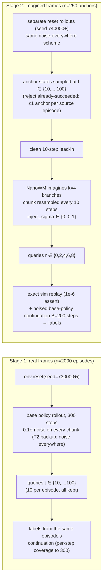

# SAILOR v1 — Project Overview

> Full pre-registration document: [`docs/decisions/sailor_v1.md`](./decisions/sailor_v1.md); config: [`configs/sailor_v1_reset.yaml`](../../../configs/sailor_v1_reset.yaml)

## 1. Purpose and Method

**Purpose**: Validate the SAILOR approach (arXiv 2506.05294) on PushT — use a Reward Model (RM) + Value Model (V) to score and rank candidate action chunks from the base policy inside the world model's (NanoWM) **imagined rollouts**, and answer:

> Can a ValueNet (V + RM heads) trained on NanoWM latents rank candidate chunks on imagined rollouts, with an offline Best-of-N success-rate improvement significantly greater than 0?

An OracleNet (ground-truth 8-dim state) serves as the upper-bound reference, decomposing the gap into "encoder loss" vs. "WM hallucination". Online Best-of-N is out of scope.

### RM and V Model Design

- **ValueNet**: input = 3 frames of SD-VAE latents (H=3, fi=5) + agent state; three heads:
  - **V head**: BCE against the soft label `v_target = γ^T · 1[T ≤ B]` (γ=0.995, B=200-step window, T = steps from query to first coverage > 0.95; trained with β=0).
  - **RM head**: MSE after sigmoid against **ground-truth sim coverage** (stage 1 = `coverage(t)`; stage 2 = `sim_cov` after replay).
  - **pose aux**: auxiliary regression.
- **OracleNet**: 8-dim ground-truth state (agent xy/vel, CoG xy/512, sinθ, cosθ), trained with the identical procedure as the upper bound.
- **Search score**: `score = V(z_end) + β · RM(z_end)`, β ∈ {0, 0.1, 0.3} (fixed a priori; β is selected on val only; interpreted as a greedy coverage bonus).
- **Training setup**: ensemble of 5 + bootstrap; grouped three-way split (val / es / fit, grouped by episode / anchor); Normalizer fitted on the fit split only; a shuffled-label control is mandatory.

## 2. Stage 1 / Stage 2 Data Collection Pipeline

- **Stage 1 (real frames)**
  - Random `env.reset(seed=730000+i)`, n=2000, base policy runs the full 300 steps.
  - Per the T2(a) outcome (Δ=+1.30 pp ≤ 2 pp), the backup plan applies: **0.1σ noise on every chunk**, no queries dropped.
  - Query times t ∈ {10,…,100}; labels come directly from the same episode's real continuation.
- **Stage 2 (imagined frames)**
  - Anchors are drawn from a separate set of noised reset rollouts (seed 740000+): 250 decision points sampled at t ∈ {10,…,100}.
  - After a clean 10-step lead-in, NanoWM imagines k=4 branches, resampling the chunk every 10 steps (2 rounds), with `inject_sigma ∈ {0, 0.1}` on candidate chunks.
  - Queries at r ∈ {0,2,4,6,8} (= 0/10/20/30/40 imagined steps).
  - Labels: exact sim replay of the imagined segment (1e-6 assert), then a noised base-policy continuation of 200 steps, recording the success time and coverage.
  - σ=0 and σ=0.1 runs share the same anchor / lead-in / torch seed → the 8 candidates (k=4 × 2σ) are provably paired.

## 3. Experimental Results (Expected Comparison Tables)

> Gate thresholds are filled in by Opus at T5, before any val is seen; currently `gate: {}` and the report fails closed.

### Table A: 2×2 Diagnostic (AUROC / ECE / within-anchor AUROC / RM MAE, bootstrap 95% CI)

|  | stage-1 val (real frames) | stage-2 r=0 (real frames, stage-2 distribution) | stage-2 val r≥2 (imagined frames) |
| --- | --- | --- | --- |
| **ValueNet (latent)** | a | — | b |
| **OracleNet (state)** | c | — | d |

- `c − a` = encoder loss; `d − b` = encoder + WM hallucination (block pose only; agent state is ground truth on both sides)
- `(d−b) − (c−a)` ≈ WM hallucination; `c − d` = the imagined distribution itself is harder
- Third column (r=0): `(r=0) − (stage-1)` isolates the state-distribution shift; `(r≥2) − (r=0)` isolates imagination itself

### Table B: Gates

| gate | metric | threshold | data |
| --- | --- | --- | --- |
| G1 | stage-1 reset AUROC ≥ T1, `ECE_soft` ≤ E1 | TBD (Opus) | val |
| G2 | stage-2 r≥2 AUROC ≥ T2 | TBD | val |
| G3 | within-anchor AUROC ≥ T3 (must be below the Table D noise ceiling) | TBD | val |
| G4 | ensemble std is informative (top/bottom quintile gap of \|V − v_target\| > 0) | fixed | val |
| G5 | RM MAE (vs. true cov) stage1 ≤ M1, stage2 ≤ M2 | TBD | val |
| G6 | offline Best-of-N `mean Δ_β` one-sided 95% lower bound > 0 | fixed | **test anchors** |

### Table C: G6 Offline Best-of-N (test anchors, seed 750000+, n=100)

8 candidates per anchor (k=4 × σ∈{0, 0.1}), r=2 query; comparison:

| selection method | description |
| --- | --- |
| random pick | `S_random(i) = mean_j y_ij` (exact expectation over the 8 candidates) |
| ValueNet β ∈ {0, 0.1, 0.3} | `S_β(i) = y_{i,argmax}`; β selected on val only, only the winner is evaluated on test |
| OracleNet | upper-bound reference |
| ex-post best | `S_oracle(i) = max_j y_ij` |

- Primary metric: `Δ_β(i) = S_β(i) − S_random(i)`; the gate is a one-sided 95% lower bound of `mean_i Δ_β` > 0
- Descriptive statistic: `gap closed = (S_β − S_random) / (S_oracle − S_random)`
- Must report: `n_used`, `n_informative` (< 40 → reported as underpowered), `SD(Δ)`

### Table D: Noise Ceiling

25 stage-2 fit+es anchors are each re-labelled twice with clean continuations; report the marginal y agreement rate and the within-group `AUROC(y1, y2)` + CI; G3's T3 must be below this value.

### Stopping Rules

- G2 **or** G3 failed → stop; pivot to fixing NanoWM accuracy.
- G6 CI contains 0 → close out as "offline improvement not significant".
- No threshold may be lowered after val is seen.
