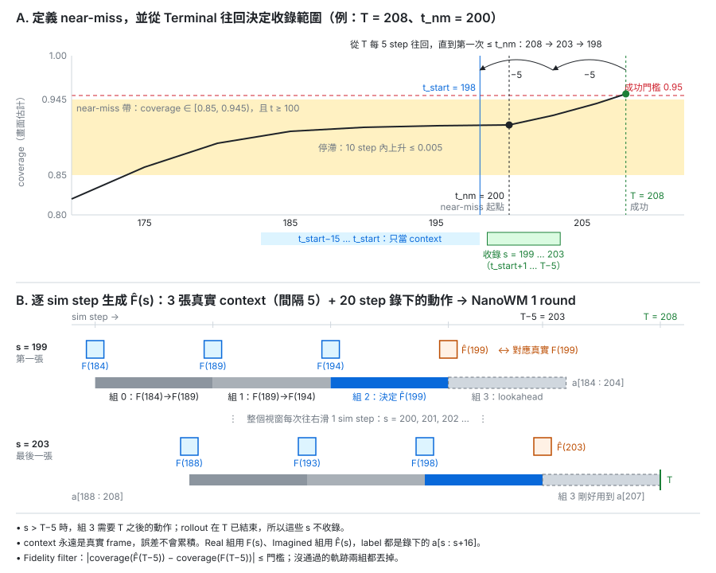

# imagined_replay

## 目的

Base policy 的失敗大多發生在終點前的停滯（near-miss）。
本實驗在 near-miss 狀態收集 base policy 的成功 rollout，再用 NanoWM 為同一批 rollout 逐 sim step 生成 imagined frame。
真實 frame 和 imagined frame 分別用來 fine-tune。

問題：label 用真實執行過的成功動作時，round-1 imagined frame 能否取代真實畫面？



## 方法

### 1. 定義 near-miss 區域

沿用 `proj/pusht/heuristic/collect_late_states.py` 的規則，只看畫面判斷。

- 100 ≤ t ≤ 290（episode 上限 300 步；一個 pair 至少需要 T − t_nm ≥ 6，所以 t > 290 不可能產生 pair）
- 畫面 coverage 估計值（`coverage_from_frame`，calibrated）落在 [0.85, 0.945)
- 過去 10 step 的 coverage 上升 ≤ 0.005（已停滯）
- episode 尚未結束；每個 episode 最多取 3 個起點，彼此間隔 ≥ 20 step

符合條件的時刻記為 near-miss 起點 t_nm。

### 2. 收集真實成功 rollout

- 每個 near-miss 起點用 base policy rollout K 次（不同 seed），只保留成功的。
  目標是起點多樣，不挑快慢。
- 決定 t_start：從 Terminal T 往前，以 5 sim step 為單位回推，直到第一次 ≤ t_nm。
  例：T = 208、t_nm = 200 → 208 → 203 → 198，t_start = 198。
- 收錄範圍：s = t_start+1 … T−5。
  不收錄 s > T−5（原因見步驟 3）。
- 記錄內容：t_start−15 到 T−5 每個 sim step 的 224px frame，以及 t_start−15 到 T 的執行動作。
  前 15 step 的 frame 只當 context，不進訓練資料。

### 3. 生成 imagined frame（round 1，逐 sim step）

```
F̂(s) ← NanoWM( F(s−15), F(s−10), F(s−5), a[s−15 : s+5] )      s = t_start+1 … T−5
```

- 3 張 context 都是真實 frame，間隔 5 sim step；視窗每次滑 1 sim step。
  context 永遠是真實 frame，誤差不會累積。
- 間隔與動作視窗依 `configs/common.yaml`（`history: 3`、`num_frames: 4`、`fi = 5`）。
  對齊遵照 `nwaug/wm/closed_loop_rollout.py` 的 alignment contract。
- 20 step 動作視窗分 4 組，每組 5 step：

  | 組 | 動作 | 作用 |
  |---|---|---|
  | 0 | a[s−15 : s−10] | F(s−15) → F(s−10) |
  | 1 | a[s−10 : s−5] | F(s−10) → F(s−5) |
  | 2 | a[s−5 : s] | F(s−5) → F̂(s) |
  | 3 | a[s : s+5] | lookahead（F̂(s) 之後） |

- 只到 T−5：s > T−5 時第 3 組需要 T 之後的動作，但 rollout 在 T 已結束。
- Fidelity filter：|coverage(F̂(T−5)) − coverage(F(T−5))| ≤ 門檻（門檻先寫進 `criteria.md`）。
  沒通過的整條軌跡，兩組都丟掉。

### 4. Fine-tune

| Arm | 訓練資料（加到原資料集上） |
|---|---|
| Real | F(s) + 錄下的 16-step 動作 a[s : s+16] |
| Imagined | F̂(s) + 同樣的動作 |
| ctrl | 只用原資料集（沿用 last-mile 的 ctrl eval） |

- Real 和 Imagined 用同一批軌跡、同樣的 s，pair 數完全相同。
- 靠近 T 的 label 會超出 T，兩組都用和原資料集相同的 episode 結尾 padding。
- 打包沿用 `nwaug/datagen/pack_closed_loop.py`。
- 劑量在步驟 0 估算後決定。
- Fine-tune seed 1000、1001，從 base checkpoint 開始，用 `proj/pusht/scripts/finetune_cl.sh`。

### 5. 評估

- 三組都在同樣的 2000 個 episode 上 eval。
- 兩個 seed 各自計算，再用 `proj/pusht/heuristic/lastmile_pooled.py` 合併。
- 指標：success rate。

## 執行順序

0. 小批試跑估算量：約 20 個起點 × K。
   記錄成功率、每條軌跡的 pair 數、fidelity filter 通過率，推算目標劑量需要多少起點。
1. 寫 `criteria.md`（劑量、arms、eval 設定）。
2. 正式收集 near-miss 起點與成功 rollout。
3. 用滑動視窗生成 imagined frame，套 fidelity filter。
4. 離線診斷（不影響判定）：每張 frame 的 block CoG 誤差、coverage 差。
5. 打包 → fine-tune（2 seeds × 2 arms）→ eval → pooled。
6. 把結果寫回 `criteria.md`。

GPU 預設用 6、7。

## 檔案

| 檔案 | 角色 |
|---|---|
| `ir_common.py` | 共用常數與 seed、near-miss 起點讀取（`load_starts` / `start`）、last-mile W anchor 的 lead-in 重建（`w_anchors` / `lastmile_env`） |
| `collect_success.py` | 步驟 0、2：找 near-miss 起點、收集成功 rollout（`starts` / `branch` / `summary`） |
| `replay_imagine.py` | 步驟 3：滑動視窗生成 F̂(s) 與 fidelity filter（`run --select terminal` / `all` / `tail`、`summary`）；NanoWM worker 沿用 `nwaug/wm/imagined_rollout.py` |
| `pack_pairs.py` | 步驟 4a：依劑量抽 pair（`select`）、打包 Real / Imagined（`pack`）、合併真實資料（`build`） |
| `run_imagined_replay.sh` | 步驟 4b–5 的 stage driver：fine-tune → eval → pooled；`IR_*` 變數切換到其他同設計的 run（例如 Img-W） |
| `truncate_eval.py` | 保留既有 eval 的前 N 個 episode（`IR_NEP` < 2000 時重用 last-mile 的 eval） |
| `lastmile_w_imagine.py` | Img-W：把 last-mile W pair 的真實 anchor frame 換成 round-1 F̂(anchor)，照 last-mile W 打包（`imagine` / `pack`） |
| `make_w_video.py` | Img-W 影片：真實 replay 與 NanoWM imagined frame 並排，附 coverage |

Seed 與 NanoWM 參數都讀自 `configs/common.yaml`：`seed_namespace.imagined_replay_*`、`seed_namespace.closed_loop_leadin`（last-mile lead-in 的 reset seed）、`seed_namespace.eval`、`nanowm`。

輸出目錄：`~/datastorage/nanowm_pusht_aug/imagined_replay/`
